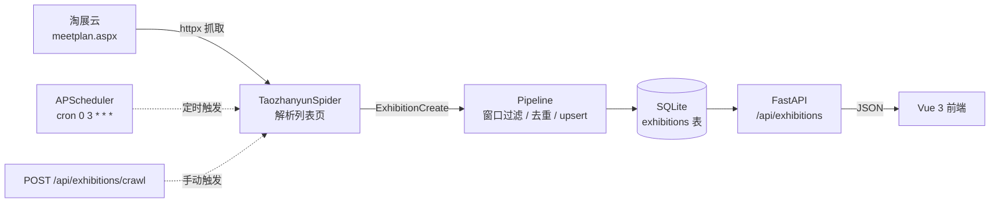

# ExhibitionHunter 开发文档

> 展会信息聚合与检索系统 · 开发规范与任务分解
>
> 文档版本：v1.1 ｜ 编制日期：2026-11-26 ｜ 适用代码库：`D:\mytools\ExhibitionHunter`

---

## 0. 文档说明

### 0.1 目的

本文档用于统一 ExhibitionHunter 的前后端开发口径，明确**当前代码真实状态**、**接口契约**、**各自的工作任务**与**协作方式**，使前后端可以并行推进而不返工。

### 0.2 读者

| 角色 | 关注章节 |
|---|---|
| 后端开发 | 第 3、4、5、7、8 章 |
| 前端开发 | 第 3、4、6、7、8 章 |
| 项目负责人 / 评审 | 第 1、3、8、9 章 |

### 0.3 约定

- 全文任务项带编号：后端 `BE-xx`，前端 `FE-xx`，跨端协作 `X-xx`。编号一经分配不再复用。
- 优先级：`P0` = 阻塞联调 / 必须做，`P1` = 首版必须，`P2` = 可迭代。
- 文中所有路径均相对仓库根目录 `D:\mytools\ExhibitionHunter`。
- **契约变更流程**：先改本文档第 4 章 → 后端实现并合并 → 前端按新契约对接。任何一方不得单方面改动接口字段。
- 标注 `【已确认】` 的结论来自对源码或运行日志的实际核查；标注 `【待拍板】` 的需要团队决策。

---

## 1. 项目概览

### 1.1 产品目标

爬取全国**正在展出 / 即将展出**的展会数据，做清洗去重后落库，通过 REST API 对外提供检索能力，前端提供可筛选、可检索的浏览界面。

**首版范围（MVP）**：单一数据源（淘展云）、列表浏览 + 关键词/城市筛选、按开始时间排序。

**明确不做（首版）**：用户体系、收藏、订阅推送、票务、参展商名录、多语言。

### 1.2 系统组成

| 组成 | 目录 | 职责 |
|---|---|---|
| 前端 | `frontend/` | Vite + Vue 3 单页应用，消费 REST API |
| 后端 | `backend/` | FastAPI 服务：爬虫采集 → 清洗去重 → SQLite → API |

### 1.3 数据流



### 1.4 技术栈

**后端**

| 组件 | 选型 | 用途 |
|---|---|---|
| Web 框架 | FastAPI 0.115.6 | 异步 API，自带 OpenAPI |
| 服务器 | uvicorn[standard] 0.34.0 | ASGI 运行 |
| HTTP 抓取 | httpx 0.28.1 | 静态页抓取 |
| HTML 解析 | selectolax 0.3.27 | 高性能 CSS 选择器解析 |
| 动态渲染 | playwright 1.49.1 | JS 渲染页兜底（按需） |
| ORM | SQLAlchemy 2.0.36（async） | 数据访问 |
| 驱动 | aiosqlite 0.20.0 | 异步 SQLite |
| 调度 | APScheduler 3.11.0 | 定时爬取 |
| 校验/配置 | Pydantic 2.10.4 / pydantic-settings 2.7.1 | Schema 与环境配置 |
| 日志 | loguru 0.7.3 | 文件 + 控制台日志 |

**前端**

| 组件 | 选型 | 说明 |
|---|---|---|
| 构建 | Vite 8.3.5（`overrides.rolldown=1.2.15`） | 见 `frontend/package.json` |
| 框架 | Vue 3.5.44（`<script setup>`） | Composition API |
| 路由 | **尚未引入** | 建议 vue-router 4 |
| 状态 | **尚未引入** | 建议 Pinia 或组合式函数 |
| HTTP | **尚未引入** | 建议原生 `fetch` 封装或 axios |
| UI / 样式 | 原生 CSS（Vite 模板默认样式） | 【待拍板】是否引入组件库 |

---

## 2. 目录结构与关键文件

```
ExhibitionHunter/
├─ README.md                      # 项目总览（已有）
├─ doc/
│  └─ 开发文档.md                 # 本文档
├─ backend/                       # FastAPI 服务
│  ├─ app/
│  │  ├─ main.py                  # 应用入口、lifespan、路由挂载
│  │  ├─ api/exhibitions.py       # 展会路由（列表 / 手动爬取）
│  │  ├─ core/config.py           # Settings（pydantic-settings，读 .env）
│  │  ├─ core/database.py         # async engine / session / Base / init_db
│  │  ├─ core/logging.py          # loguru 配置
│  │  ├─ models/exhibition.py     # Exhibition ORM 模型
│  │  ├─ schemas/exhibition.py    # Pydantic 出入参
│  │  ├─ crawler/
│  │  │  ├─ base.py               # BaseSpider 抽象（fetch/parse/crawl/run）
│  │  │  ├─ pipelines.py          # 清洗 + 去重 + upsert + 统计
│  │  │  ├─ scheduler.py          # APScheduler 集成
│  │  │  └─ sites/
│  │  │     ├─ __init__.py        # ALL_SPIDERS 注册表
│  │  │     └─ taozhanyun_spider.py  # 淘展云爬虫（已实现）
│  │  └─ services/                # 业务逻辑层（当前为空占位）
│  ├─ data/                       # 运行时生成：SQLite + 日志
│  ├─ requirements.txt
│  ├─ .env / .env.example
│  └─ README.md
└─ frontend/                      # Vue 3（当前为 Vite 脚手架）
   ├─ index.html
   ├─ vite.config.js
   ├─ package.json
   ├─ public/
   └─ src/
      ├─ main.js
      ├─ App.vue
      ├─ style.css
      ├─ components/HelloWorld.vue  # 模板演示组件，待删除
      └─ assets/                    # 模板图片，待清理
```

### 2.1 关键文件索引

| 文件 | 作用 | 维护方 |
|---|---|---|
| [backend/app/main.py](../backend/app/main.py) | 应用装配、lifespan、健康检查 | 后端 |
| [backend/app/api/exhibitions.py](../backend/app/api/exhibitions.py) | 接口实现、筛选与分页逻辑 | 后端 |
| [backend/app/core/config.py](../backend/app/core/config.py) | 全部环境变量的唯一来源 | 后端 |
| [backend/app/core/database.py](../backend/app/core/database.py) | 会话依赖 `get_db`、建表 | 后端 |
| [backend/app/models/exhibition.py](../backend/app/models/exhibition.py) | 表结构与唯一索引 | 后端 |
| [backend/app/schemas/exhibition.py](../backend/app/schemas/exhibition.py) | 接口出入参（≈ 前端类型来源） | 后端 |
| [backend/app/crawler/base.py](../backend/app/crawler/base.py) | 爬虫扩展点 | 后端 |
| [backend/app/crawler/sites/__init__.py](../backend/app/crawler/sites/__init__.py) | 爬虫注册表 `ALL_SPIDERS` | 后端 |
| [frontend/vite.config.js](../frontend/vite.config.js) | 开发代理（待加）、构建配置 | 前端 |
| [frontend/src/App.vue](../frontend/src/App.vue) | 根组件（待重写） | 前端 |

---

## 3. 当前状态评估

### 3.1 后端

| 模块 | 状态 | 说明 |
|---|---|---|
| 应用装配与启动 | ✅ 可用 | `lifespan` 完成日志初始化、建表、启动调度器 |
| 数据模型与建表 | ✅ 可用 | `create_all` 建表；`ux_exhibitions_source` 唯一索引生效 |
| 列表接口 | ✅ 可用 | 分页 + 状态 + 城市/行业/关键词筛选 |
| 手动爬取接口 | ⚠️ 可用但粗糙 | 同步阻塞、无鉴权、无幂等保护 |
| 爬虫框架 | ✅ 可用 | httpx/playwright 双引擎、异常隔离、优雅关闭 client |
| 淘展云爬虫 | ✅ 实测可用 | 运行日志显示 2026/2027 两年分页抓取成功，第 6 页空页终止、2027 年触达窗口截止 |
| 定时任务 | ✅ 可用（关机有缺陷） | cron `0 3 * * *`；`stop_scheduler` 存在 await 同步方法的问题，见 DI-02 |
| 日志 | ✅ 基本可用 | loguru 按天 + 10MB 轮转、保留 14 天 |
| services 层 | ❌ 空 | 仅 `__init__.py`，业务逻辑目前混在 api 与 crawler 中 |
| 跨域 | ❌ 缺失 | 未配置 `CORSMiddleware`，见 DI-01 |
| 详情接口 | ❌ 缺失 | 无 `GET /api/exhibitions/{id}`，见 BE-06 |
| 筛选项接口 | ❌ 缺失 | 城市/行业候选值无处可取，见 BE-07 |
| 并发抓取 | ⚠️ 未实现 | `crawler_max_concurrency` 配置项从未被读取，实际全串行 |
| 测试 / CI / Lint | ❌ 缺失 | 无测试目录、无 ruff/eslint 配置、无流水线 |
| 数据库迁移 | ❌ 缺失 | 依赖 `create_all`，字段变更无法平滑升级 |

### 3.2 前端

**结论：落地面（landing page）首版已完成并跑通真实数据，模板脚手架已清除。**

已实现（详见 6.7）：

- 首页：Hero + 搜索 + 状态切换 + 展会卡片列表 + 分页；
- API 层：`api/client.js`（超时、取消、错误归一化）+ `api/exhibitions.js`；
- 状态层：`composables/useExhibitionList.js`（防抖、请求取消、分页边界）；
- 四种页面状态：骨架屏 / 有数据 / 空结果 / 请求失败；
- 开发代理：`/api` → `127.0.0.1:8000`，本地联调无需 CORS；
- 响应式（360px～1440px）与暗色模式；
- Vite 模板资产（`HelloWorld.vue`、`hero.png`、`vite.svg`、`vue.svg`、`icons.svg`）已删除。

仍未做：

- 详情页（阻塞于 `BE-06`）、城市筛选（阻塞于 `BE-07`）；
- 路由（当前是单页，尚未引入 vue-router）、状态管理库（当前用组合式函数足够）；
- ESLint/Prettier 配置、单元测试。

> 端口提醒：开发服务器默认 `5173`，若被占用 Vite 会自动顺延（本机实测为 `5174`），以终端输出的 `Local:` 为准。

### 3.3 两端联动现状

- **已打通**：前端经 Vite 代理请求 `/api/exhibitions`，实测渲染 12 张卡片、67 条总数、状态切换后 54 条；
- 仍缺：后端 CORS（`BE-02`）——当前依赖代理，若前端独立域名部署或直接连 `:8000` 会被浏览器拦截；
- 仍缺：详情接口（`BE-06`）与筛选项接口（`BE-07`）——卡片暂不可点击、城市筛选暂未上；
- 后端未启动时，前端会展示"连不上后端服务"并给出启动命令，不会白屏。

---

## 4. 接口契约（前后端共同遵守）

### 4.1 服务与地址

| 项 | 值 |
|---|---|
| 后端地址 | `http://127.0.0.1:8000` |
| API 前缀 | `/api`（`settings.api_v1_prefix`） |
| 交互式文档 | `http://127.0.0.1:8000/docs` |
| OpenAPI JSON | `http://127.0.0.1:8000/openapi.json` |
| 前端开发地址 | `http://127.0.0.1:5173` |
| 时间格式 | ISO 8601，**无时区偏移的本地时间**（如 `2026-12-05T00:00:00`） |

> ⚠️ 后端所有时间字段来自 `datetime.now()` / 爬取解析，均为**朴素本地时间**，前端不得按 UTC 解析。日期型字段显示时按 `YYYY-MM-DD` 截断即可。

### 4.2 数据模型 `Exhibition`

| 字段 | 类型 | 可空 | 来源 | 说明 |
|---|---|---|---|---|
| `id` | int | 否 | 自增 | 主键 |
| `source_site` | string(64) | 否 | 爬虫 | 站点标识，如 `taozhanyun` |
| `source_id` | string(128) | 否 | 爬虫 | 站内唯一 ID（当前为 `md5(title\|start_date)` 前 16 位） |
| `source_url` | string(512) | 否 | 爬虫 | 数据来源页 URL（**注意：是列表页 URL，非详情页**） |
| `title` | string(256) | 否 | 爬虫 | 展会名称 |
| `city` | string(64) | 是 | 爬虫 | 城市 |
| `venue` | string(256) | 是 | 爬虫 | 展馆 |
| `industry` | string(128) | 是 | — | **当前无数据源，恒为空** |
| `start_date` | datetime | 是 | 爬虫 | 开始日期 |
| `end_date` | datetime | 是 | 爬虫 | 结束日期 |
| `cover_image` | string(512) | 是 | — | **当前恒为空** |
| `description` | text | 是 | — | **当前恒为空** |
| `organizer` | string(256) | 是 | — | **当前恒为空** |
| `created_at` | datetime | 否 | DB `now()` | 入库时间 |
| `updated_at` | datetime | 否 | DB `now()` / onupdate | 更新时间 |

唯一约束：`(source_site, source_id)`。

**前端必须处理的现实情况**：`industry`、`cover_image`、`description`、`organizer` 四个字段首版**永远为 null**。前端不得依赖它们做筛选条件或卡片主视觉，需准备占位图与降级布局。

### 4.3 展会状态口径

后端以查询时刻 `now` 为基准计算，**不落库状态字段**：

| `status` 取值 | 条件 | 语义 |
|---|---|---|
| `ongoing` | `start_date <= now <= end_date` | 正在展出 |
| `upcoming` | `start_date > now` | 即将开始 |
| `all`（默认） | `end_date >= now` | 未结束（= 进行中 + 即将开始），**已结束的不返回** |

> 📌 语义陷阱（`DI-03`）：`all` 实际含义是"有效/未结束"，不是"全部历史"。前端文案不要写成"全部"以免误导，建议展示为"全部在展"或"近期"。
>
> 📌 `start_date` / `end_date` 为 NULL 的记录**不会出现在任何 status 下**（SQL 中 `NULL >= now` 为 NULL，条件不成立）。

前端展示状态标签时按本地当前时间自行推导：

```js
// 前端状态推导（与后端口径保持一致）
function deriveStatus(item, now = new Date()) {
  const s = item.start_date ? new Date(item.start_date) : null
  const e = item.end_date ? new Date(item.end_date) : null
  if (s && s > now) return 'upcoming'
  if (e && e < now) return 'ended'
  return 'ongoing'
}
```

### 4.4 `GET /api/exhibitions` — 展会列表

**请求参数**

| 参数 | 类型 | 默认 | 约束 | 说明 |
|---|---|---|---|---|
| `page` | int | `1` | `>= 1` | 页码，从 1 开始 |
| `page_size` | int | `20` | `1 ~ 100` | 每页条数 |
| `status` | string | `all` | `ongoing` / `upcoming` / `all` | 状态筛选 |
| `city` | string | 无 | — | **精确匹配**（非模糊、非多选） |
| `industry` | string | 无 | — | 精确匹配（当前无数据） |
| `keyword` | string | 无 | — | **仅匹配 `title`** 的 `LIKE %kw%` |

**排序**：`start_date ASC NULLS LAST`（越早开始越靠前）。

**响应 `200`**（`ExhibitionPage`）

```json
{
  "items": [
    {
      "id": 128,
      "source_site": "taozhanyun",
      "source_id": "9f2c1d7a4b8e5c60",
      "source_url": "http://www.taozhanyun.com/meetplan.aspx?city=&keyword=&meetid=&month=&year=2026&page=2",
      "title": "2026 中国国际食品加工与包装展览会",
      "city": "上海",
      "venue": "国家会展中心（上海）",
      "industry": null,
      "start_date": "2026-12-05T00:00:00",
      "end_date": "2026-12-07T00:00:00",
      "cover_image": null,
      "description": null,
      "organizer": null,
      "created_at": "2026-11-04T21:46:02",
      "updated_at": "2026-11-04T21:46:02"
    }
  ],
  "total": 128,
  "page": 1,
  "page_size": 20
}
```

**分页约定**：`total` 是当前筛选条件下的总数；前端页数 = `Math.ceil(total / page_size)`；`items` 为空时 `200` + `items: []`，**不是 404**。

### 4.5 `POST /api/exhibitions/crawl` — 手动触发爬取

- 无请求体、无鉴权。
- **同步执行**：一次请求会跑完所有站点才返回。实测单页约 0.2s，当前全量（1 个站点、7 次请求）约 2s；耗时随接入站点数与页数线性增长，期间连接一直被占用。
- 响应 `200`：

```json
[{ "site": "taozhanyun", "fetched": 150, "new": 12, "updated": 138 }]
```

| 字段 | 含义 |
|---|---|
| `fetched` | 解析出的条数（含窗口内被跳过的） |
| `new` | 新建记录数 |
| `updated` | 命中已有 `(source_site, source_id)` 而更新的条数 |

- 失败返回 `500` + `{"detail": "<异常信息>"}`。
- ⚠️ 仅供运维/调试使用，**不得暴露在前端页面上**（无鉴权、可被刷）。

### 4.6 `GET /health`

```json
{ "status": "ok", "name": "ExhibitionHunter API" }
```

### 4.7 `GET /`

```json
{ "name": "ExhibitionHunter API", "docs": "/docs", "api": "/api" }
```

### 4.8 错误约定

当前使用 FastAPI 默认错误体：

```json
{ "detail": "Not Found" }
```

| 状态码 | 场景 |
|---|---|
| `422` | 参数校验失败（如 `page=0`、`page_size=101`、`status=xxx`），`detail` 为字段级数组 |
| `500` | 服务端异常（爬取失败等） |

**前端统一处理**：`422` 视为前端 bug（打印参数），`5xx` 展示"服务暂时不可用 + 重试"，网络错误展示"网络异常"。

### 4.9 契约缺口（前端受阻项，需后端补齐）

| 缺口 | 影响的前端功能 | 对应任务 |
|---|---|---|
| 无 `GET /api/exhibitions/{id}` | 详情页无法打开 | `BE-06` |
| 无城市/行业候选值接口 | 筛选下拉框无数据 | `BE-07` |
| 无 CORS 配置 | 跨端口直连被拦截 | `BE-02` |
| `source_url` 是列表页 | "查看原页"跳转后定位不到该展会 | `BE-09` |
| 无排序参数 | 无法按"最新收录"排序 | `BE-08` |

---

## 5. 后端开发工作

### 5.1 配置与运行环境

**原则**：所有可配置项集中在 [backend/app/core/config.py](../backend/app/core/config.py)，通过 `.env` 注入，代码中不得出现魔法值。

**环境变量清单**

| 变量 | 默认值 | 说明 | 状态 |
|---|---|---|---|
| `APP_NAME` | `ExhibitionHunter API` | 应用名 | 生效 |
| `DEBUG` | `false`（`.env.example` 为 `true`） | 调试模式；为真时 SQL 回显 + 全量堆栈 | 生效 |
| `API_V1_PREFIX` | `/api` | 路由前缀 | 生效 |
| `DATABASE_URL` | `sqlite+aiosqlite:///./data/exhibitions.db` | 数据库连接串 | 生效（路径依赖见 DI-04） |
| `CRAWLER_DEFAULT_ENGINE` | `auto` | `auto` / `httpx` / `playwright` 全局引擎 | 生效 |
| `CRAWLER_MAX_CONCURRENCY` | `4` | 单次爬取并发上限 | **未使用** |
| `CRAWLER_USER_AGENT` | Chrome 130 UA | 请求 UA | 生效 |
| `CRAWLER_FUTURE_MONTHS` | `3` | 只保留未来 N 个月内的展会 | 生效（按 `N*30` 天折算） |
| `SCHEDULER_ENABLED` | `false`（`.env.example` 为 `true`） | 是否启用定时爬取 | 生效 |
| `SCHEDULER_CRAWL_CRON` | `0 3 * * *` | cron 表达式（每日 03:00） | 生效 |
| `LOG_LEVEL` | `INFO` | 日志级别 | 生效 |
| `LOG_DIR` | `./data/logs` | 日志目录 | 生效 |

**必须遵守**：`uvicorn` **只能在 `backend/` 目录下启动**。因为 `DATABASE_URL` 是相对路径，由 SQLAlchemy 按**进程工作目录**解析；从仓库根启动会把库建到仓库根下，导致"数据看不到"的假故障（见 `DI-04`）。

### 5.2 数据层

- 模型定义在 [backend/app/models/exhibition.py](../backend/app/models/exhibition.py)，继承 `Base`（`DeclarativeBase`），使用 `Mapped[...]` 类型标注风格。
- 新增模型必须同时在 `app/models/__init__.py` 导出，否则 `init_db()` 的 `create_all` 不会建表。
- 会话统一通过 `get_db` 依赖注入，**禁止在路由中直接 `AsyncSessionLocal()`**（爬虫管线属例外，它不在请求周期内）。
- `get_db` 已在正常路径 `commit`、异常路径 `rollback`，路由内不要再手动 `commit`。

### 5.3 API 层

现有实现见 [backend/app/api/exhibitions.py](../backend/app/api/exhibitions.py)。后续约束：

1. 路由文件只做**参数校验 + 调用 service + 组装响应**，业务逻辑下沉 `app/services/`（当前为空，见 `BE-04`）。
2. 新增接口必须带 `response_model`，让 `/docs` 成为唯一可信契约。
3. 列表类接口统一返回 `{items, total, page, page_size}` 结构。
4. 明确区分"参数非法（422）"与"资源不存在（404）"。

### 5.4 爬虫层

**架构**（[backend/app/crawler/base.py](../backend/app/crawler/base.py)）

```
BaseSpider
├─ fetch(url)            引擎选择：httpx / playwright / auto(先 httpx 失败降级)
├─ parse(html, url)      抽象方法：单页解析，yield ExhibitionCreate
├─ crawl()               默认按 start_urls 逐页调用 parse；分页站点可覆写
└─ run()                 管线入口，finally 关闭 httpx client
```

**两种扩展路径**

| 场景 | 做法 |
|---|---|
| 单页/固定 URL 列表 | 设 `start_urls` + 实现 `parse()` |
| 需要翻页 / 提前终止 | 覆写 `crawl()`，自行控制页码与本类 `_stop` 标志（参考 [淘展云实现](../backend/app/crawler/sites/taozhanyun_spider.py)） |

**新增数据源 SOP**

1. 在 `app/crawler/sites/` 新建 `xxx_spider.py`，继承 `BaseSpider`；
2. 设定 `name`（唯一、入库即 `source_site`）、`engine`（服务端渲染页用 `httpx`，JS 渲染页用 `playwright` 或 `auto`）；
3. `parse()` 内完成字段提取与**容错**：日期解析失败 `continue`，不抛异常中断整页；
4. 生成 `source_id`：优先用站内真实 ID；无 ID 时用稳定业务键哈希（当前为 `md5(title|start_date)`）；
5. 在 [sites/__init__.py](../backend/app/crawler/sites/__init__.py) 的 `ALL_SPIDERS` 注册；
6. 本地用 `POST /api/exhibitions/crawl` 验证 `fetched/new/updated` 三项均大于 0；
7. 同步更新本文档第 4 章"数据源"与 README。

**运行注意**

- `run()` 会在结束后关闭 client，**同一 spider 实例不可复用**；
- 单站失败只 `continue`，不影响其他站点；
- 抓取应遵守目标站规则，控制频率；当前全串行，未来引入并发时需同时加限速（`BE-11`）；
- 日志中已出现目标站返回 `500` 的瞬时失败记录（2026-11-04 21:36），管线已能隔离，无需特别处理。

### 5.5 调度

- `start_scheduler()` 幂等（已存在则复用），仅在 `SCHEDULER_ENABLED=true` 且 cron 非空时注册任务 `crawl_all`，`coalesce=True` 防止堆积。
- **缺陷**：`stop_scheduler()` 中 `await _scheduler.shutdown(wait=False)` 的 `shutdown` 是同步方法（APScheduler 3.11 `base.py:221`、`schedulers/asyncio.py:40` 均为 `def shutdown(self, wait=True)`），`await` 会抛 `TypeError`，表现为服务退出时报错。修复见 `BE-03`。
- 定时任务与手动接口共用 `run_all`，**无互斥锁**：cron 触发时手动再触发会并发跑两份。见 `BE-12`。

### 5.6 服务层（待建）

`app/services/` 目前为空。建议拆分：

| 文件 | 职责 |
|---|---|
| `services/exhibition_service.py` | 列表查询、详情查询、筛选候选值聚合 |
| `services/crawl_service.py` | 爬取触发、并发互斥、运行记录 |

拆分后 [api/exhibitions.py](../backend/app/api/exhibitions.py) 仅保留 HTTP 层职责，便于单测与复用。

### 5.7 日志与可观测

- 统一使用 `from loguru import logger`，禁止 `print`。
- 需要堆栈时用 `logger.exception`，业务分支用 `logger.info/warning`。
- 关键日志保留上下文：`[spider_name] url`、`stats`。
- 建议补充：请求访问日志中间件（`BE-14`）、爬取运行记录表（`BE-13`）。

### 5.8 测试

当前零测试。最低要求（`BE-15`）：

| 层级 | 工具 | 覆盖点 |
|---|---|---|
| 单测 | pytest + pytest-asyncio | `parse()` 用固定 HTML 快照断言字段；状态筛选条件构造 |
| 接口测 | httpx.AsyncClient + ASGITransport + 内存库 | 200/422/分页边界 |
| 冒烟 | 脚本 | `uvicorn` 启动 → `/health` → `/api/exhibitions` |

### 5.9 后端任务清单

| 编号 | 任务 | 验收标准 | 优先级 |
|---|---|---|---|
| `BE-01` | 统一并校正 `.env` / `.env.example` 默认值（`SCHEDULER_ENABLED`、`DEBUG` 说明） | 两处默认值口径一致；README 与实际一致 | P0 |
| `BE-02` | 配置 CORS：允许 `http://localhost:5173`、`http://127.0.0.1:5173`，方法与头按需放开 | 浏览器直连 `:8000` 不再报跨域；生产环境通过环境变量配置白名单 | P0 |
| `BE-03` | 修复 `stop_scheduler` 的 `await` 同步方法缺陷 | 服务正常退出无 `TypeError`，日志出现 `Shutdown complete` | P0 |
| `BE-04` | 建立 `services/` 层，迁移查询与爬取触发逻辑 | 路由文件内不再出现复杂查询构造；接口行为不变 | P1 |
| `BE-05` | 修正 `DATABASE_URL` 相对路径问题：用 `settings.db_path` 构造绝对路径 | 从仓库根或 `backend/` 启动均落到 `backend/data/exhibitions.db` | P1 |
| `BE-06` | 新增 `GET /api/exhibitions/{id}` | 命中返回 `200` + `ExhibitionOut`；未命中 `404`；`/docs` 可见 | P0 |
| `BE-07` | 新增筛选项接口（城市 / 行业候选值及其数量） | 返回去重排序后的城市列表；前端可据此渲染下拉框 | P0 |
| `BE-08` | 列表接口支持 `sort` 参数（`start_date` / `created_at`，升降序） | 参数非法返回 `422`；默认行为不变 | P2 |
| `BE-09` | 为每条展会提取真实详情页 URL（新增 `detail_url` 字段或修正 `source_url` 语义） | 前端可从卡片跳转到对应展会详情页 | P1 |
| `BE-10` | `POST /api/exhibitions/crawl` 改为异步任务：立即返回任务 ID，或改为后台任务 + 状态查询 | 请求立即返回、不等待爬取完成；重复触发有明确响应 | P1 |
| `BE-11` | 实现 `CRAWLER_MAX_CONCURRENCY` 或有据可依地移除该项 | 配置项与实际行为一致；加并发时限速 | P2 |
| `BE-12` | 爬取任务互斥锁，避免定时与手动并发 | 并发触发时第二次直接返回"正在爬取" | P1 |
| `BE-13` | 爬取运行记录（站点、开始/结束时间、条数、错误）入库 | 可从库中查历史运行结果 | P2 |
| `BE-14` | 增加请求访问日志中间件（方法、路径、耗时、状态码） | 日志中可按请求排查问题 | P2 |
| `BE-15` | 补测试：`parse()` 快照 + 接口用例 + 启动冒烟 | 覆盖 ≥ 3 类用例，可一条命令运行 | P1 |
| `BE-16` | 引入 ruff 格式化与静态检查，清理无用导入（`pipelines.py` 的 `datetime`、`sqlite_insert`） | `ruff check` 零告警 | P2 |
| `BE-17` | 引入 Alembic 迁移，替代裸 `create_all` | 新增字段可通过迁移脚本升级已有库 | P2 |
| `BE-18` | 去重策略加固：`source_id` 变更不产生重复行（改用稳定站内 ID 或补二次合并规则） | 标题变更后仍能命中同一条记录 | P1 |

> 补充说明 `BE-18`：当前 `source_id = md5(title|start_date)[:16]`，展会改名或改期即生成新 ID，旧记录若"未结束"会与新记录同时出现在列表里，造成重复展示。这是首版最主要的脏数据来源。

---

## 6. 前端开发工作

### 6.1 现状与目标

现状：Vite + Vue 3 脚手架，仅有一个演示组件。目标：从零搭建**展会检索单页应用**。

**首版页面**（建议 2 个路由）

| 路由 | 页面 | 说明 |
|---|---|---|
| `/` | 展会列表页 | 筛选条 + 卡片网格 + 分页；首版即便无详情页也必须可用 |
| `/exhibitions/:id` | 展会详情页 | 依赖 `BE-06`，接口未就绪前先做骨架与空态 |

**【待拍板】技术选型**（建议值，需负责人确认）

| 决策点 | 建议 | 备选 |
|---|---|---|
| 路由 | vue-router 4 | — |
| 状态 | Pinia | 组合式函数 + `provide/inject` |
| HTTP | 封装原生 `fetch` | axios |
| UI 组件库 | 不引入，手写 CSS（视觉简单、体积小） | Element Plus / Naive UI / Tailwind |
| 类型 | 首版 JS；后续可用 `openapi-typescript` 从 `/openapi.json` 生成类型 | 手写 TS 类型 |

### 6.2 工程基建

1. **清理模板**：删除 `components/HelloWorld.vue`、`assets/hero.png`、`assets/vite.svg`、`assets/vue.svg`、`public/icons.svg`；重写 `App.vue`、`style.css`、`index.html`。
2. **环境变量**：新建 `.env.development` / `.env.production`，定义 `VITE_API_BASE_URL`（开发留空走代理，生产填真实域名）。
3. **开发代理**（推荐，优先于 CORS）：在 [frontend/vite.config.js](../frontend/vite.config.js) 增加：

```js
export default defineConfig({
  plugins: [vue()],
  server: {
    port: 5173,
    proxy: {
      '/api': {
        target: 'http://127.0.0.1:8000',
        changeOrigin: true,
      },
    },
  },
})
```

> 代理与 `BE-02` 的 CORS 应二者其一即可跑通联调；建议**两者都做**——代理解决开发期，CORS 解决生产期跨域部署。

4. **代码规范**：ESLint（`eslint-plugin-vue`）+ Prettier，统一 2 空格缩进、单引号、无分号（与现有 `main.js` 风格一致）。
5. **目录约定**：

```
src/
├─ main.js
├─ App.vue
├─ router/index.js
├─ api/
│  ├─ client.js          # fetch 封装：baseURL、超时、错误归一化
│  └─ exhibitions.js     # 接口函数
├─ stores/exhibitions.js # 筛选条件与结果状态
├─ composables/          # useExhibitions、useDebounce 等
├─ components/
│  ├─ FilterBar.vue
│  ├─ ExhibitionCard.vue
│  ├─ ExhibitionGrid.vue
│  ├─ PaginationBar.vue
│  └─ EmptyState.vue / ErrorState.vue / LoadingSkeleton.vue
├─ views/
│  ├─ ExhibitionListView.vue
│  └─ ExhibitionDetailView.vue
└─ utils/date.js         # 日期格式化、状态推导
```

### 6.3 API 客户端

**要点**

- 统一 `baseURL`（`import.meta.env.VITE_API_BASE_URL ?? ''`），统一超时（建议 15s，`AbortController`）。
- 统一错误归一化：把 422 / 500 / 网络错误 / 超时映射为 `{ kind, message, detail }`，页面只处理 `kind`。
- **必须实现请求取消**：筛选条件快速变化时取消上一个请求，避免旧响应覆盖新结果（`FE-08`）。
- 禁止在组件内直接 `fetch`，一律经由 `api/` 层。

```js
// api/exhibitions.js
export function listExhibitions(params, signal) {
  const qs = new URLSearchParams(
    Object.entries(params).filter(([, v]) => v !== '' && v != null)
  ).toString()
  return request(`/api/exhibitions?${qs}`, { signal })
}
```

### 6.4 页面与组件规格

#### 6.4.1 筛选条 `FilterBar`

| 控件 | 绑定参数 | 交互 |
|---|---|---|
| 状态切换（在展中 / 即将开始 / 全部在展） | `status` | 切换即查询，回到第 1 页 |
| 关键词输入 | `keyword` | 300ms 防抖；回车立即查询 |
| 城市下拉 | `city` | 数据来自 `BE-07`；精确匹配 |
| 每页条数 | `page_size` | 默认 20，可选 20/40/60 |

**必须做到**：筛选条件写进 URL query（`router.replace`），保证刷新/分享后条件不丢（`FE-07`）。

#### 6.4.2 卡片 `ExhibitionCard`

信息层级：**标题 → 日期区间 → 城市 · 展馆 → 状态标签**。

- 状态标签：`ongoing` = 绿「展出中」，`upcoming` = 蓝「即将开始」，`ended` = 灰「已结束」（`ended` 仅详情页可能出现）。
- 日期展示：同月显示 `12月5日 - 7日`，跨月 `12月5日 - 1月3日`，缺结束日显示 `12月5日 起`。
- 无 `cover_image` 时用纯色/渐变占位块 + 首字，**不得留破图**。
- 城市/展馆缺失时整段不渲染，不留 `null` 字样。

#### 6.4.3 列表页状态

| 状态 | 呈现 |
|---|---|
| 首次加载 | 骨架屏（与卡片同尺寸，≥6 个） |
| 空结果 | 插图 + "没有找到符合条件的展会" + 「清除筛选」按钮 |
| 请求失败 | 错误提示 + 「重试」按钮，保留已有筛选条件 |
| 加载更多/翻页 | 按钮禁用态 + 顶部细进度条 |

#### 6.4.4 分页 `PaginationBar`

- 上一页 / 下一页 + 当前页 / 总页数 + 跳转输入。
- `total = 0` 时整个分页条隐藏。
- 切页后滚动回列表顶部。

### 6.5 前后端对接注意事项

1. **时间为本地朴素时间**：直接 `new Date(str)` 在 UTC+8 环境下解析一致，但**不要**再叠加时区换算；只取年月日时用字符串截断更稳。
2. **`all` 不等于全部**：文案与交互不要暗示"历史全量"。
3. **`industry` 恒为 null**：首版不要做行业筛选，等后端补齐数据源再做。
4. **`keyword` 只搜标题**：占位文案写"搜索展会名称"，不要写"搜索展会/展馆/主办方"。
5. **`city` 精确匹配**：下拉框必须来自后端候选值，禁止让用户自由输入（否则"上海市"匹配不到"上海"）。
6. **`source_url` 是列表页**：不要做成"查看官方详情"按钮，等 `BE-09` 提供真实详情 URL。
7. 后端 `page_size` 上限 100，前端选项不要超过它。

### 6.6 前端任务清单

| 编号 | 任务 | 验收标准 | 优先级 |
|---|---|---|---|
| `FE-01` | 清理 Vite 模板资产，重写 `App.vue` / `style.css` / `index.html`（中文标题、`lang="zh-CN"`） | 页面无任何 Vite/Vue 模板内容残留 | P0 |
| `FE-02` | 搭建基础工程：目录结构、`router`、全局样式变量（颜色/间距/字号 token） | 空路由可切换，样式变量可复用 | P0 |
| `FE-03` | 配置开发代理与 `VITE_API_BASE_URL` | 浏览器 Network 中 `/api/*` 成功返回数据 | P0 |
| `FE-04` | 封装 `api/client.js`（baseURL、超时、错误归一化）+ `api/exhibitions.js` | 页面不出现裸 `fetch`；错误可区分超时/网络/业务 | P0 |
| `FE-05` | 列表页骨架：加载中 / 空 / 错误 / 有数据 四态 | 四种状态均可通过改参数复现 | P0 |
| `FE-06` | `ExhibitionCard` + 网格布局（响应式 1/2/3/4 列） | 360px ~ 1440px 无横向滚动、不重叠 | P0 |
| `FE-07` | 筛选条 + 条件同步到 URL query | 刷新页面后筛选条件与结果一致 | P1 |
| `FE-08` | 关键词防抖 + 请求取消（`AbortController`） | 快速输入不出现结果错乱 | P1 |
| `FE-09` | 分页组件与切页滚动复位 | 翻页后列表回到顶部；`total=0` 隐藏分页 | P1 |
| `FE-10` | 日期格式化与状态标签推导（`utils/date.js`） | 跨月、缺结束日、已结束三种情况显示正确 | P1 |
| `FE-11` | 详情页（依赖 `BE-06`）：骨架 + 字段展示 + 返回列表保留筛选 | 直达详情 URL 可打开；返回后筛选不丢 | P1 |
| `FE-12` | 城市下拉接入 `BE-07` 候选值接口 | 下拉项来自接口，选中后结果条数与 `total` 一致 | P1 |
| `FE-13` | 响应式与暗色模式适配（沿用 `prefers-color-scheme`） | 亮/暗两套下文字对比度达标 | P2 |
| `FE-14` | 无障碍与语义化：卡片为可聚焦元素、图片 `alt`、表单 `label` | 键盘可完成"筛选→翻页→进详情"全流程 | P2 |
| `FE-15` | ESLint + Prettier 配置并全量通过 | `npm run lint` 零错误 | P2 |
| `FE-16` | 构建校验：`npm run build` 产物可 `preview` 正常访问 | 产物无控制台报错 | P2 |

---

### 6.7 已落地（landing page v1.1）

对应任务：`FE-01`～`FE-06` 完成，`FE-07`（筛选+URL 同步）与 `FE-08`（防抖+取消）部分完成。

**新增/改动文件**

| 文件 | 职责 |
|---|---|
| `frontend/vite.config.js` | 增加 `/api` 开发代理 |
| `frontend/index.html` | 中文标题、`lang="zh-CN"`、SEO/主题色 |
| `frontend/public/favicon.svg` | 自绘站点图标 |
| `frontend/src/style.css` | 设计变量（明/暗）、页面骨架、`.btn`/`.pill` 等基础件 |
| `frontend/src/App.vue` | 页面装配 |
| `frontend/src/components/AppHeader.vue` | 顶栏与总数状态 |
| `frontend/src/components/HeroPanel.vue` | Hero、搜索框、状态切换 |
| `frontend/src/components/ExhibitionGrid.vue` | 列表容器与四态分支 |
| `frontend/src/components/ExhibitionCard.vue` | 卡片（日期角标 / 地点 / 展期 / 状态 / 倒计时） |
| `frontend/src/components/CardSkeleton.vue` | 骨架屏 |
| `frontend/src/components/StatePanel.vue` | 空态 / 错误态 |
| `frontend/src/components/PaginationBar.vue` | 分页 |
| `frontend/src/api/client.js` | fetch 封装：超时、取消、错误归一化 |
| `frontend/src/api/exhibitions.js` | 列表接口函数 |
| `frontend/src/composables/useExhibitionList.js` | 查询状态、防抖、请求取消、分页边界 |
| `frontend/src/utils/date.js` | 展期格式化、状态推导、倒计时 |
| `frontend/src/utils/accent.js` | 标题哈希 → 卡片色相 |
| `frontend/.env.example` | `VITE_API_BASE_URL` 说明 |
| `tools/preview_check.py` | 渲染自检：卡片数、首条文案、控制台错误、整页截图 |
| `tools/preview_flow.py` | 交互自检：切标签 / 空结果 / 后端不可达 / 移动端溢出 |

**验证结果**（2026-11-26，后端 8000 + 前端 5174）

| 场景 | 结果 |
|---|---|
| 首屏 | 12 张卡片，`共 67 场 · 第 1 / 6 页`，无控制台报错 |
| 切「即将开始」 | 12 张卡片全部为"即将开始"，`共 54 场 · 第 1 / 5 页` |
| 搜索无结果 | 0 张卡片，展示"没有符合条件的展会"+ 清除筛选 |
| 后端不可达 | 展示"连不上后端服务"+ 启动命令 + 重试 |
| 390px 视口 | 12 张卡片单列，无横向滚动 |
| 生产构建 | `npm run build` 通过，CSS 13.5 kB / JS 81.2 kB（gzip 3.7 + 31.7 kB） |

界面预览见 `doc/screenshots/`。

**下一步（前端）**：`FE-11` 详情页需等 `BE-06`；`FE-12` 城市下拉需等 `BE-07`；`FE-13`～`FE-16`（暗色打磨、无障碍、lint、构建校验）可立即做。

---

## 7. 前后端协作约定

### 7.1 契约优先

1. 接口先写进第 4 章，再写代码。
2. 后端提交前自检：`/openapi.json` 中的 schema 与文档一致。
3. 字段**只增不改不删**；确需变更时，后端与前端在同一迭代内完成并同步更新本文档。
4. 新增可空字段，前端必须按"可能为 null"渲染。

### 7.2 联调流程

| 步骤 | 后端 | 前端 |
|---|---|---|
| 1 | `cd backend` → 激活 venv → `uvicorn app.main:app --reload --port 8000` | `cd frontend` → `npm run dev` |
| 2 | 自查 `/docs` 接口可用、`/health` 返回 ok | 确认代理生效（Network 中 `/api/exhibitions` 为 200） |
| 3 | 需要数据时 `POST /api/exhibitions/crawl` | 用真实数据校验四种页面状态 |
| 4 | 记录接口变更到本文档 | 记录受阻接口到 4.9 节 |

**数据为空时先别急着怀疑前端**：`status=all` 只返回未结束的展会，若数据库中展会都已过期，列表就是空的。可直接查库确认：

```powershell
# 在 backend/ 目录下
python -c "import sqlite3;c=sqlite3.connect('data/exhibitions.db');print(c.execute('select count(*) from exhibitions').fetchone())"
```

### 7.3 命名与数据约定

| 项 | 约定 |
|---|---|
| JSON 字段 | `snake_case`（与后端一致，前端不做驼峰转换） |
| 分页参数 | `page`（从 1 开始）/ `page_size` |
| 时间 | ISO 8601 无时区字符串 |
| 空值 | `null`（不是 `""`）；前端统一判 `== null` |
| 状态值 | `ongoing` / `upcoming` / `all`（小写） |
| 站点标识 | `source_site` 使用小写英文，如 `taozhanyun` |

### 7.4 分工边界

| 事项 | 负责方 |
|---|---|
| 数据结构、字段语义、去重规则 | 后端 |
| 页面状态、交互细节、视觉、空/错态 | 前端 |
| 接口契约文本 | 后端起草，前端确认 |
| CORS / 代理 | 后端配 CORS，前端配代理，各自负责自己一侧 |
| 线上部署、进程守护 | 后端主导 |
| 前端构建产物托管、CDN | 前端主导 |

### 7.5 跨端协作任务

| 编号 | 任务 | 验收标准 | 双方分工 | 优先级 |
|---|---|---|---|---|
| `X-01` | 打通联调链路（CORS 与代理） | 前端 Network 中接口请求返回 200，控制台无跨域报错 | 后端 `BE-02` 配白名单；前端 `FE-03` 配 `/api` 代理 | P0 |
| `X-02` | 锁定接口契约清单，评审 4.9 节缺口补齐顺序 | 4.9 节五项缺口均已挂任务编号并排期 | 后端起草，前端确认 | P0 |
| `X-03` | 定义统一的空/错/加载态语义与错误码约定 | 前端四种页面状态与后端状态码一一对应，无歧义 | 后端定 `status` 与错误码，前端实现表现层 | P1 |
| `X-04` | 准备联调数据集（各状态、各城市、含缺字段的样本） | 库中存在 ongoing/upcoming/缺日期三类样本各 ≥ 1 条 | 后端造数，前端据此验收 | P1 |
| `X-05` | 首批端到端验收（M1 验收清单） | 筛选 → 翻页 → 详情 → 返回，全流程通过 | 双方同步执行 | P1 |

---

## 8. 已知问题与技术债

| 编号 | 问题 | 影响 | 责任方 | 处理 |
|---|---|---|---|---|
| `DI-01` | 后端未配置 `CORSMiddleware` | 前端跨端口直连被浏览器拦截，联调失败 | 后端 | `BE-02` |
| `DI-02` | `stop_scheduler` 中 `await` 了同步方法 `shutdown`【已确认，APScheduler 3.11 源码为 `def shutdown`】 | 服务退出时抛 `TypeError`，日志出现异常 | 后端 | `BE-03` |
| `DI-03` | `status=all` 实为"未结束"，命名与语义不符 | 前端文案易误导；无法查历史展会 | 后端 | 文档标注 + 后续加 `ended` 选项 |
| `DI-04` | `DATABASE_URL` 相对路径按进程 CWD 解析，`settings.db_path` 未被使用 | 启动目录不同 → 库位置不同，出现"数据丢失"假象 | 后端 | `BE-05` |
| `DI-05` | `start_date`/`end_date` 为 NULL 的记录在任何 status 下都查不到 | 部分数据静默不可见 | 后端 | 入库时补齐或允许 NULL 排序 |
| `DI-06` | `industry`/`cover_image`/`description`/`organizer` 无数据源 | 前端四字段恒为 null，卡片与详情信息单薄 | 后端 | 扩展采集字段或接入新数据源 |
| `DI-07` | `source_id` 由标题+日期哈希生成，改名/改期即产生新记录 | 列表重复展示同展会，`total` 虚高 | 后端 | `BE-18` |
| `DI-08` | `POST /crawl` 同步阻塞、无鉴权、无互斥 | 连接占用随数据源增长、可被反复触发、与定时任务撞车 | 后端 | `BE-10`、`BE-12` |
| `DI-09` | `pipelines.run_spider` 在异常时 `rollback` 会丢弃本批已 add 未提交的数据 | 单条异常导致整批回滚（虽会抛出让上层感知） | 后端 | 改为逐条提交或 savepoint |
| `DI-10` | `CRAWLER_MAX_CONCURRENCY` 从未被读取 | 配置项形同虚设 | 后端 | `BE-11` |
| `DI-11` | `SCHEDULER_ENABLED` 代码默认 `false`，`.env.example` 为 `true` | 新环境行为不一致 | 后端 | `BE-01` |
| `DI-12` | 无测试、无 lint、无 CI | 回归靠手工，重构风险高 | 两端 | `BE-15`/`BE-16`/`FE-15` |
| `DI-13` | 无数据库迁移机制，仅 `create_all` | 字段变更需手工改库 | 后端 | `BE-17` |
| `DI-14` | 前端为脚手架原样，业务代码为零 | 项目一半工作量尚未开始 | 前端 | 第 6 章 |
| `DI-15` | 前端无任何 API 层与错误处理 | 直接写页面会导致异常状态未覆盖 | 前端 | `FE-04`、`FE-05` |
| `DI-16` | `frontend` 使用 Vite 8 + `overrides.rolldown`，构建链较新 | 与 CI/团队环境可能不一致 | 前端 | 提交 `package-lock.json`，锁定 Node 版本 |
| `DI-17` | `source_url` 指向列表页而非详情页 | "查看原页"定位不到具体展会 | 后端 | `BE-09` |
| `DI-18` | 爬虫无 robots 校验、无速率限制（仅 30s 超时） | 存在被目标站限流/封禁风险 | 后端 | 加限速与重试退避 |

---

## 9. 里程碑计划

### M0 · 联调打通（最小闭环）

| 交付 | 负责 | 完成标志 |
|---|---|---|
| CORS / 代理二选一生效 | 后端 `BE-02` + 前端 `FE-03` | 浏览器能拿到真实数据 |
| 列表页只读渲染 | 前端 `FE-01`~`FE-06` | 打开页面能看到展会卡片 |
| 后端可稳定启动与退出 | 后端 `BE-03` | 无 `TypeError`，`/health` 正常 |

**验收**：`curl http://127.0.0.1:8000/api/exhibitions?page=1&page_size=5` 返回数据，前端页面渲染出这 5 条。

### M1 · 首版可用

| 交付 | 负责 |
|---|---|
| 详情接口 + 筛选项接口 | 后端 `BE-06`、`BE-07` |
| 筛选、分页、URL 同步、四种页面状态 | 前端 `FE-07`~`FE-12` |
| 去重加固，清理重复数据 | 后端 `BE-18` |

**验收**：可从列表筛选"上海 + 关键词"→ 翻页 → 点进详情 → 返回保留筛选条件。

### M2 · 质量与稳定

| 交付 | 负责 |
|---|---|
| 测试与静态检查 | `BE-15`、`BE-16`、`FE-15` |
| 爬取异步化 + 互斥 + 运行记录 | `BE-10`、`BE-12`、`BE-13` |
| 服务层重构 | `BE-04` |
| 响应式与暗色、无障碍 | `FE-13`、`FE-14` |

### M3 · 上线

| 交付 | 负责 |
|---|---|
| 部署脚本 / 进程守护 / 反向代理 | 后端 |
| 前端构建产物托管 | 前端 |
| 监控与告警（爬取失败率、接口错误率） | 后端 |
| 第二个数据源接入 | 后端 `5.4` SOP |

---

## 10. 附录

### 10.1 本地启动

**后端**

```powershell
cd backend
python -m venv .venv                      # 首次
.\.venv\Scripts\Activate.ps1
pip install -r requirements.txt
playwright install chromium               # 仅动态渲染站点需要
copy .env.example .env                    # 首次
uvicorn app.main:app --reload --port 8000
```

**前端**

```powershell
cd frontend
npm install
npm run dev                               # http://localhost:5173
```

### 10.2 常用命令

| 目的 | 命令（在对应目录执行） |
|---|---|
| 查看接口文档 | 浏览器打开 `http://127.0.0.1:8000/docs` |
| 手动触发爬取 | `curl -X POST http://127.0.0.1:8000/api/exhibitions/crawl` |
| 查数据条数 | `python -c "import sqlite3;c=sqlite3.connect('data/exhibitions.db');print(c.execute('select count(*) from exhibitions').fetchone())"` |
| 查看最新日志 | `Get-Content data\logs\app_$(Get-Date -Format yyyy-MM-dd).log -Tail 50` |
| 前端构建 | `npm run build` → `npm run preview` |

### 10.3 术语表

| 术语 | 含义 |
|---|---|
| Spider | 单个数据源的爬虫实现，对应 `source_site` |
| Pipeline | 抓取之后的清洗、去重、入库流程 |
| 窗口期 | `CRAWLER_FUTURE_MONTHS` 限定的"未来 N 个月"范围，超出则不采集 |
| upsert | 按 `(source_site, source_id)` 判定，存在则更新、不存在则插入 |
| 引擎 | 抓取方式：`httpx`（静态）/ `playwright`（JS 渲染）/ `auto`（先静态后降级） |

### 10.4 变更记录

| 版本 | 日期 | 变更 |
|---|---|---|
| v1.0 | 2026-11-26 | 首版：依据当前代码与运行日志完成现状评估、契约定义与前后端任务分解 |
| v1.1 | 2026-11-26 | 前端 landing page 首版落地：更新 3.2/3.3 现状，新增 6.7 已落地清单与验证结果 |
